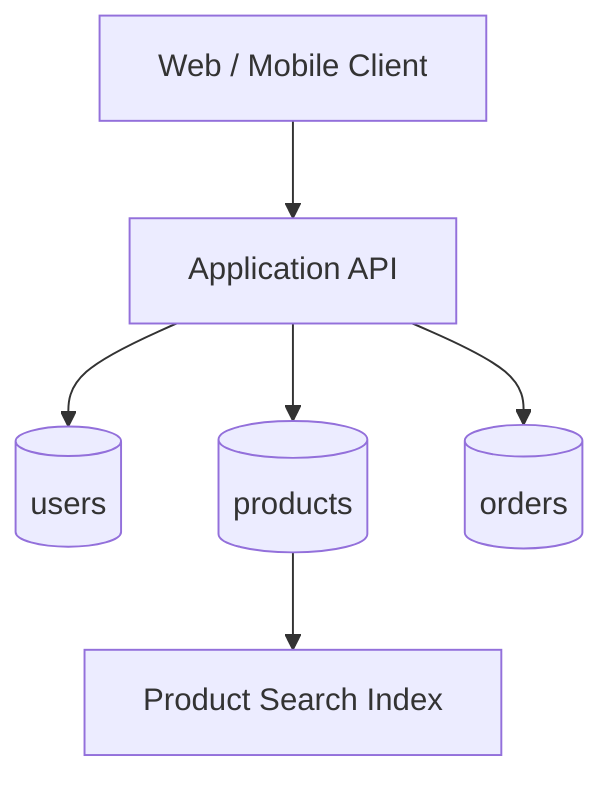
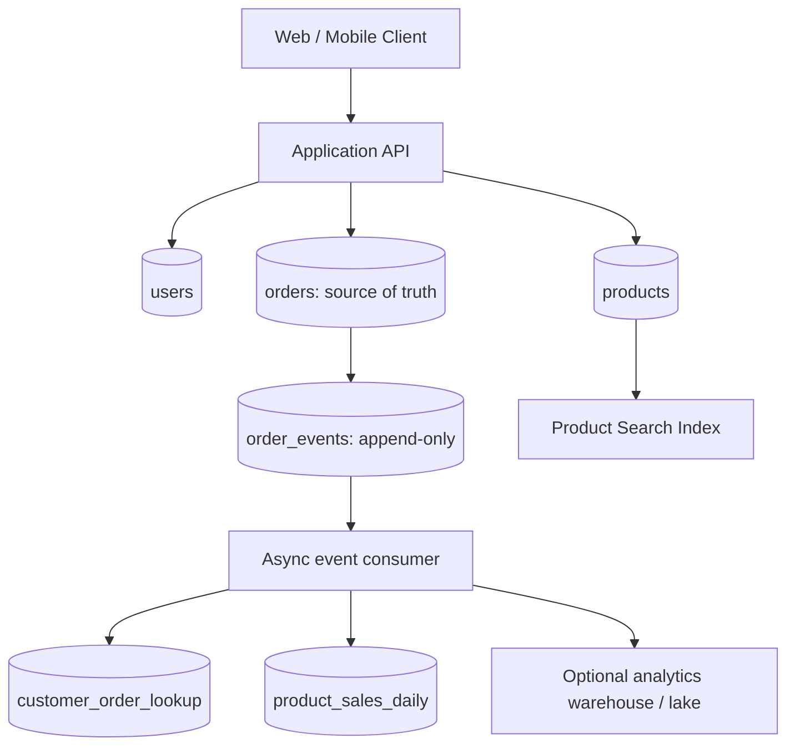

# Architecture Overview

## Initial operational design

The initial design optimizes transactional reads and writes. Product search may use a dedicated search index depending on the selected deployment.

## Refactored design

These are logical data-flow diagrams; actual deployment and service configuration depend on the selected provider and cluster topology.
